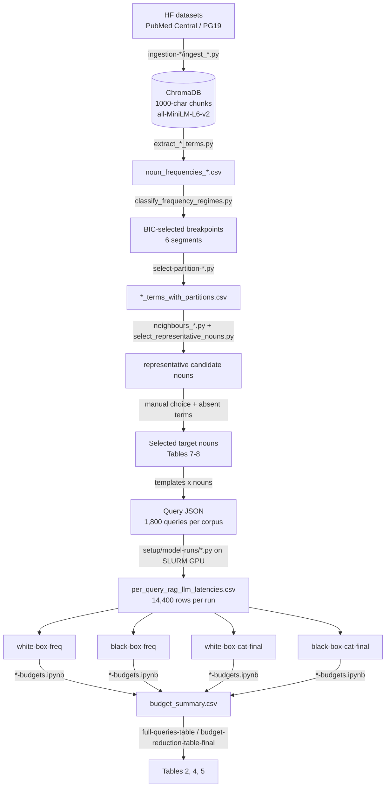

# Timing Side-Channel Attacks on RAG in Edge LLMs

Code, data and results for the paper **"Feasibility of timing attacks to Retrieval-Augmented Generation in edge LLMs"**.

> **Release status.** The paper is currently under review. This repository is a **partial release**: it contains all the code, the query datasets, the selected target nouns, and the aggregated results behind every figure and table (metrics, confusion matrices, classification reports, budget summaries, LaTeX tables), together with a sample of the raw timing data. The full raw latency measurements, large intermediate files and detailed per-run outputs **are available from the authors upon request** and will be released once the paper is accepted. See [Data availability](#0-data-availability) for the exact list.

The paper shows that the **execution time** of a RAG-based chatbot leaks information about:

1. **What is inside the RAG corpus** (*RAG content frequency inference*). Given a noun, an attacker infers how frequent it is in the hidden knowledge base. There are six classes: *Very high, High, Moderate, Low, Very low, Term not present*.
2. **What a legitimate user is asking about** (*topic inference of RAG uses*). Given only the timing of a victim's query, the attacker infers the semantic category of its target noun (5 classes per corpus).

Both attacks are evaluated against two attacker models:

| | Black-box attacker | White-box attacker |
|---|---|---|
| Knows the corpus `D` | No | Yes |
| Observes | end-to-end latency `L_e2e` (+ query length, answer size) | `L_e2e` + internal latencies `L_ret`, `L_fmt`, `L_llm` (+ sizes) |
| Frequency attack | sends its own queries; semi-supervised, labels only 3 "anchor" classes | supervised on the known corpus, predicts the victim's hidden noun |
| Topic attack | times victim queries | times victim queries |

The experiments cover 2 corpora (PubMed Central and PG19), 3 edge LLMs (SmolLM2-135M-Instruct, Qwen2.5-0.5B-Instruct, Granite-3.0-1b-a400m-instruct), and runs with and without an application-level Redis cache. KV-cache and ChromaDB caching are always on. Each configuration is also tested under six query budgets (100% down to 5%).

---

## 0. Data availability

### Included in this repository

| What | Where |
|---|---|
| All source code: ingestion, noun extraction, segmented regression, partitioning, neighbourhood filter, RAG runners, SLURM jobs, attack notebooks, table notebooks | every folder |
| Query templates, selected target nouns (Tables 7–8) and the final query datasets (1,800 queries per corpus) | `queries/Queries-creation/`, `setup/datasets/partitions/` |
| Noun frequency lists and noun-to-partition assignments | `term-frequencies-partitions/term_frequencies-*/` |
| Breakpoints, BIC tables, stability tables and Fig. 2 | `visuals-frequency-distributions-both-experiments/frequency_regime_results/` |
| Per model × corpus × cache setting: `metrics.json`, confusion matrices (`.csv/.png/.pdf`), classification reports, model selection and split audit | `classificators/*/{no-cache,cache}/*_results/` |
| Budget curves and `budget_summary.csv` for every experiment | `classificators/*/{no-cache,cache}/*_budget_results/` |
| Model-difference results, Table 2 and Tables 4–5 | `*_model_differences_results/`, `classificators/budget_reduction_tables_final/` |
| **Sample raw timing data:** Qwen2.5-0.5B-Instruct, no Redis cache, both corpora (14,400 executions each) | `classificators/white-box-freq/no-cache/per_query_rag_llm_latencies_ordered_qwen_{pg19,pubmed}.csv` |

### Available upon request

The following items are **not** included in this first release. They will be provided by the authors upon request and published once the paper is accepted:

- **Raw latency measurements** (`per_query_rag_llm_latencies_*.csv`) for the remaining 10 runs: SmolLM2 and Granite without cache, and all three models with the Redis cache.
- **Large intermediate files (> 100 MB) of the neighbourhood-representativeness filter (Step 5):** `*_terms_with_neighbour_scores*.csv`, `*_terms_with_relaxed_representativeness.csv`, and the derived `*_representative_terms*.csv` candidate lists.
- **Full ranked tables of the segmented regression** (`frequency_regime_results/*_unclassified.csv`).
- **Detailed per-run outputs:** per-query / per-noun predictions (`held_out_predictions.csv`, `noun_predictions_seed0.csv`), feature importances (`feature_importance.csv`), permutation-test null distributions (`permutation_null.csv`), and the per-budget, per-model sub-runs (`*_budget_results/{random,shared}_templates/`).
- **Auxiliary analyses not reported in the paper** (curated vs. randomly drawn nouns, with its random query set) and **earlier iterations of the topic attack** that were superseded by the final method.

Contact: Marina Buitrago-Perez — marina.buitrago@alumnos.uc3m.es

---

## Table of contents

0. [Data availability](#0-data-availability)
1. [Pipeline at a glance](#1-pipeline-at-a-glance)
2. [Repository layout](#2-repository-layout)
3. [Requirements](#3-requirements)
4. [Quick start: reproduce the paper's tables from the released latencies](#4-quick-start-reproduce-the-papers-tables-from-the-released-latencies)
5. [Full pipeline, step by step](#5-full-pipeline-step-by-step)
   - [Step 1: Build the RAG vector stores](#step-1-build-the-rag-vector-stores-paper-51)
   - [Step 2: Extract noun frequencies](#step-2-extract-noun-frequencies-paper-421)
   - [Step 3: Segmented rank-frequency regression (strata)](#step-3-segmented-rank-frequency-regression-paper-421-52)
   - [Step 4: Assign every noun to a partition](#step-4-assign-every-noun-to-a-partition)
   - [Step 5: Neighbourhood representativeness filter](#step-5-neighbourhood-representativeness-filter-paper-531)
   - [Step 6: Choose the target nouns](#step-6-choose-the-target-nouns-paper-531-tables-78)
   - [Step 7: Build the query datasets](#step-7-build-the-query-datasets-paper-532)
   - [Step 8: Run the RAG timing experiments](#step-8-run-the-rag-timing-experiments-paper-533)
   - [Step 9: Hand the latency CSVs to the classifiers](#step-9-hand-the-latency-csvs-to-the-classifiers)
   - [Step 10: White-box frequency attack](#step-10-white-box-frequency-attack-paper-422-631)
   - [Step 11: Black-box frequency attack](#step-11-black-box-frequency-attack-paper-413-632)
   - [Step 12: Topic inference attack (both boxes)](#step-12-topic-inference-attack-both-boxes-paper-64)
   - [Step 13: Query-budget reduction](#step-13-query-budget-reduction-paper-534-65)
   - [Step 14: Model differences and paper tables](#step-14-model-differences-and-paper-tables)
6. [Metrics](#6-metrics)
7. [Where each paper figure and table comes from](#7-where-each-paper-figure-and-table-comes-from)
8. [Auxiliary analyses](#8-auxiliary-analyses)
9. [Earlier iterations (not used in the paper)](#9-earlier-iterations-not-used-in-the-paper)
10. [Known issues and path assumptions](#10-known-issues-and-path-assumptions)
11. [Citation](#11-citation)

---

## 1. Pipeline at a glance



| Paper section | What happens | Where |
|---|---|---|
| §5.1 | Chunk + embed corpora into ChromaDB | `ingestion-pubmed/`, `ingestion-pg19/` |
| §4.2.1 | Noun extraction, FPM, rank | `term-frequencies-partitions/*/extract_*_terms.py` |
| §4.2.1, §5.2 | Segmented regression, BIC, breakpoint stability (Fig. 2) | `visuals-frequency-distributions-both-experiments/` |
| §4.2.1 | Partition every noun | `term-frequencies-partitions/*/select-partition-*.py` |
| §5.3.1 | Neighbourhood check ("year", "synvitro" excluded) | `term-frequencies-partitions/*/term_frequencies_neighbours/` |
| §5.3.1–5.3.2 | Target nouns, templates, query JSON | `queries/Queries-creation/`, `setup/datasets/` |
| §5.3.3, §5.4 | RAG execution and latency measurement (H200, SLURM, Redis) | `setup/model-runs/`, `setup/slurms/` |
| §4.2.2, §6.3.1 | White-box frequency attack | `classificators/white-box-freq/` |
| §4.1.3, §6.3.2 | Black-box frequency attack | `classificators/black-box-freq/` |
| §6.4 | Topic attack (white and black box) | `classificators/{white,black}-box-cat-final/` + `classificators/final_topic.py` |
| §5.3.4, §6.5 | Query budgets (Tables 4, 5) | `*-budgets.ipynb` in each experiment folder |
| §6 | Table 2, Tables 4/5 | `classificators/full-queries-table.ipynb`, `classificators/budget-reduction-table-final.ipynb` |

---

## 2. Repository layout

Items marked *(on request)* are not included in this release (see [§0](#0-data-availability)).

```
Timing-Attacks-RAG-Edge-LLMs/
├── ingestion-pubmed/                 # Step 1 (PubMed): ingest_pubmed.py, inspect_dataset.py
├── ingestion-pg19/                   # Step 1 (PG19):   ingest_pg19.py
├── term-frequencies-partitions/
│   ├── term_frequencies-pubmed/      # Steps 2, 4, 5 for PubMed
│   │   ├── extract_pubmed_terms.py
│   │   ├── noun_frequencies_pubmed.csv
│   │   ├── pubmed_terms_with_partitions.csv
│   │   └── term_frequencies_neighbours/
│   │       ├── neighbours_pubmed.py
│   │       ├── select_representative_nouns.py
│   │       ├── output_neighbours/            # neighbour scores, large CSVs (on request)
│   │       └── pubmed_representative_terms_relaxed.csv   # (on request)
│   └── term_frequencies-pg19/        # Same for PG19
├── visuals-frequency-distributions-both-experiments/
│   ├── classify_frequency_regimes.py # Step 3: segmented regression + BIC + stability
│   ├── plot_combined_segmented_fit.py# Fig. 2
│   ├── frequency-distributions-both.py
│   └── frequency_regime_results/     # breakpoints, BIC tables, stability tables
├── queries/
│   ├── Queries-creation/             # Step 6-7: templates, selected nouns, JSON skeletons
│   └── length-queries-visuals/       # query-length-by-category analysis
├── setup/
│   ├── datasets/partitions/          # Query JSON used in the paper (1,800 queries / corpus)
│   ├── model-runs/                   # Step 8: 12 runner scripts (3 models x 2 corpora x cache on/off)
│   └── slurms/                       # SLURM job files that launched those runners
└── classificators/                   # Steps 9-14: attacks, budgets, tables
    ├── white-box-freq/{no-cache,cache}/   # no-cache/ also holds the sample latency CSVs (Qwen2.5)
    ├── black-box-freq/{no-cache,cache}/
    ├── white-box-cat-final/{no-cache,cache}/
    ├── black-box-cat-final/{no-cache,cache}/
    ├── final_topic.py                # shared topic-attack implementation
    ├── full-queries-table.ipynb      # Table 2
    ├── budget-reduction-table-final.ipynb  # Tables 4 and 5
    └── budget_reduction_tables_final/
```

Earlier iterations of the topic attack and auxiliary analyses are not part of this release (see [§9](#9-earlier-iterations-not-used-in-the-paper)).

---

## 3. Requirements

The work was split across two machines (paper §5.4). You need different things depending on which part you run.

### 3.1 GPU node: Steps 1, 2, 5 and 8

Used: one NVIDIA H200, 20 CPU cores, up to 128 GB RAM (the SLURM files request 250 GB), SLURM.

Python packages imported by the scripts:

```
torch  transformers  sentence-transformers  datasets
chromadb  langchain-core  langchain-chroma  langchain-huggingface
langchain-redis  redis  pydantic
spacy  (+ models: en_core_web_sm, en_core_web_trf)
pandas  numpy  scipy  matplotlib  seaborn
```

```bash
python -m venv venv && source venv/bin/activate
pip install torch transformers sentence-transformers datasets chromadb \
            langchain-core langchain-chroma langchain-huggingface langchain-redis redis \
            spacy pandas numpy scipy matplotlib seaborn
python -m spacy download en_core_web_sm
python -m spacy download en_core_web_trf     # only for PG19 noun extraction (GPU)
```

**Redis (cache runs only).** You need a Redis server with the **RediSearch** and **RedisJSON** modules (vector search). The cache SLURM jobs start a private `redis-server` on a Unix socket and load `/usr/lib/redis/modules/{rejson,redisearch}.so`. Redis 8 ships both modules.

> The exact package versions used on the cluster were written by the cache SLURM jobs to `experiment-*/packages-<jobid>.txt` (`pip freeze`). Those files are not in this folder.

### 3.2 Analysis machine: Steps 3, 4 and 9–14

Used: Apple M1, 16 GB. No GPU is needed. The local `.venv` has:

```
Python 3.14, numpy 2.5.3, pandas 3.0.6, scipy 1.18.1, scikit-learn 1.9.1,
matplotlib 3.11.2, seaborn 0.13.2, jupyter / ipykernel
```

```bash
python -m venv .venv && source .venv/bin/activate
pip install numpy pandas scipy scikit-learn matplotlib seaborn jupyter
```

---

## 4. Quick start: reproduce the paper's results from the released latencies

This release includes the raw latencies of **one configuration**, Qwen2.5-0.5B-Instruct without Redis cache, for both corpora. They are in `classificators/white-box-freq/no-cache/`. You can therefore re-run the attacks for this configuration without a GPU. The latency files for the other 10 runs are available upon request ([§0](#0-data-availability)).

Every notebook reads its inputs **relative to its own folder**, so always execute it from that folder:

```bash
source .venv/bin/activate
cd classificators/white-box-freq/no-cache

# white-box frequency attack, Qwen2.5, PG19 (writes pg19_qwen_white_box_freq_results/, Fig. 3 left)
jupyter nbconvert --to notebook --execute --inplace pg19-freq-qwen-white-box.ipynb
jupyter nbconvert --to notebook --execute --inplace pubmed-freq-qwen-white-box.ipynb
```

All four experiments read the same latency file. To run the black-box frequency attack or the topic attacks on the sample, copy the two CSVs into the matching `no-cache/` folder:

```bash
cd classificators
for e in black-box-freq white-box-cat-final black-box-cat-final; do
  cp white-box-freq/no-cache/per_query_rag_llm_latencies_ordered_qwen_*.csv $e/no-cache/
done
```

The budget notebooks (`*-budgets.ipynb`) and the model-difference notebooks loop over all three models, so they need the full set of latency files. Their outputs (`budget_summary.csv`, `metrics.json`) are already included, so the table notebooks run as they are:

```bash
cd classificators
jupyter nbconvert --to notebook --execute --inplace full-queries-table.ipynb          # Table 2
jupyter nbconvert --to notebook --execute --inplace budget-reduction-table-final.ipynb # Tables 4-5
```

The frequency notebooks also run as plain scripts, because each one ends with an `argparse` `__main__`. You can export the code cell and call it with `--csv <file> --output <dir>`.

> **Runtime.** Topic notebooks run a permutation test with 50 permutations. Each permutation repeats a full nested cross-validation (5 outer × 3 inner folds × 4 candidate models), so expect minutes to hours per notebook on a laptop.

---

## 5. Full pipeline, step by step

### Step 1: Build the RAG vector stores (paper §5.1)

**Scripts:** `ingestion-pubmed/ingest_pubmed.py`, `ingestion-pg19/ingest_pg19.py`

| | PubMed | PG19 |
|---|---|---|
| Hugging Face dataset | `timaeus/pile-pubmed_central` (1.49 GB) | `emozilla/pg19` (7.06 GB) |
| Text field | `text` | `text` |
| Chroma path / collection | `./workspace/pubmed_central` / `pubmed_central` | `./workspace/pg19` / `pg19` |
| Chunk ID prefix | `pubmed_000000000` | `pg19_000000000` |

**What the script does:**

1. Streams the dataset from Hugging Face (`streaming=True`), so it is never fully loaded into memory.
2. Splits each document into **contiguous, non-overlapping 1,000-character windows**. The last window is kept only if it has at least 50 characters.
3. Embeds the chunks with **`all-MiniLM-L6-v2`** (384-d), on GPU if available, in encoder batches of **512**.
4. Buffers **5,000** chunks and then calls `collection.add(...)` with metadata `{dataset, document_index, chunk_id, chunk_start}`.
5. After each document it writes the document index to `./workspace/checkpoint_<corpus>.txt`. Re-running the script resumes from the next document. `Ctrl-C` is safe.

```bash
cd <project-root>               # the script writes ./workspace relative to the CWD
python ingestion-pubmed/inspect_dataset.py   # optional: print the fields of the first record
python ingestion-pubmed/ingest_pubmed.py
python ingestion-pg19/ingest_pg19.py
```

Set `MAX_DOCUMENTS = 100` (or `1000`) at the top of the script for a quick test. If CUDA runs out of memory, lower `ENCODE_BATCH_SIZE` first.

> **Small difference between the two scripts.** PubMed strips each chunk and keeps it if it has **more than 50** characters. PG19 does not strip and keeps it if it has **at least 50** characters.

### Step 2: Extract noun frequencies (paper §4.2.1)

**Scripts:** `term-frequencies-partitions/term_frequencies-pubmed/extract_pubmed_terms.py`, `term-frequencies-partitions/term_frequencies-pg19/extract_pg19_terms.py`

1. Reads every chunk back from ChromaDB, in pages of 5,000.
2. Runs spaCy (parser and NER disabled) and keeps tokens that pass all of these filters:
   - POS is `NOUN` or `PROPN`
   - the token is purely alphabetic
   - the lemma has at least 4 characters
   - it is not a spaCy stop word
   - **PubMed only:** it is not in a list of generic biomedical stop-nouns (`study, patient, cell, protein, gene, …`)
3. Counts lower-cased lemmas.
4. Writes `noun_frequencies_<corpus>.csv` (`term,frequency`) with every noun seen **at least twice** (`MIN_FREQUENCY_TO_SAVE = 2`). This is the "types occurring fewer than twice are removed" step of §5.2.
5. Saves a top-50 bar chart. The PG19 script also saves a log-log Zipf plot and a histogram.

| | spaCy model | Device |
|---|---|---|
| PubMed | `en_core_web_sm` | CPU |
| PG19 | `en_core_web_trf` | GPU (`spacy.require_gpu()`) |

Outputs used later: `noun_frequencies_pubmed.csv` (522,777 nouns), `noun_frequencies_pg19.csv` (1,159,866 nouns).

### Step 3: Segmented rank-frequency regression (paper §4.2.1, §5.2)

**Script:** `visuals-frequency-distributions-both-experiments/classify_frequency_regimes.py`

This step implements Equations (3)–(8) of the paper:

1. **Normalise:** `FPM_i = c_i / Σ c_j × 10^6` (frequency per million noun tokens).
2. **Rank** by decreasing FPM. Ties are broken with a stable merge-sort, so the order inside a tie is arbitrary but reproducible.
3. **Subsample for fitting:** at most `MAX_FIT_POINTS = 6000` approximately log-spaced ranks (`np.geomspace`), so the huge low-frequency tail does not dominate the fit.
4. **Fit** `log10 FPM ~ log10 rank` with a *continuous* piecewise-linear hinge model (Eq. 5) for **1 … 6 segments** (`MAX_SEGMENTS = 6`):
   - Breakpoints are found with `scipy.optimize.differential_evolution`, minimising the RSS (Eq. 6).
   - Linear coefficients are solved by least squares, conditional on the breakpoints.
   - Every segment must be at least `MIN_LOG_WIDTH = 0.15` wide in log-rank space. Invalid candidates get a large penalty.
5. **Choose the number of segments** by BIC, `n·log(RSS/n) + p·log n` with `p = 2m` (Eqs. 7–8). **BIC picks 6 segments (5 breakpoints) for both corpora.**
6. **Stability:** 30 refits on random 80% subsamples (seed 42). It records the 2.5 / 50 / 97.5 percentiles of each breakpoint.
7. Maps each breakpoint back to a real rank, raw frequency and FPM.

```bash
cd visuals-frequency-distributions-both-experiments
python classify_frequency_regimes.py      # check PG19_PATH / PUBMED_PATH first (see §10)
python plot_combined_segmented_fit.py     # Fig. 2: both corpora on one plot
python frequency-distributions-both.py    # extra rank-frequency / CCDF plots -> img-freq-distributions/
```

**Outputs** (`frequency_regime_results/`):

| File | Content |
|---|---|
| `<corpus>_bic_comparison.csv` | RSS and BIC for 1–6 segments |
| `<corpus>_breakpoints.csv` | Chosen breakpoints: log10 rank, rank, frequency, FPM |
| `<corpus>_breakpoint_stability.csv` | Subsampling intervals |
| `<corpus>_segmented_fit.png`, `<corpus>_bic.png` | Diagnostic plots |
| `<corpus>_unclassified.csv` | Full ranked table (see the note below). *Available upon request.* |
| `analysis_summary.csv` | One row per corpus |

Breakpoints obtained (rank → frequency at that rank):

| Breakpoint | PG19 rank (freq) | PubMed rank (freq) |
|---|---|---|
| 1 | 70 (577,114) | 140 (107,501) |
| 2 | 641 (119,240) | 640 (32,596) |
| 3 | 1,727 (42,030) | 1,997 (7,620) |
| 4 | 5,905 (8,080) | 17,583 (283) |
| 5 | 821,122 (3) | 77,112 (33) |

> The script still has a leftover 4-class labelling branch (`CLASS_LABELS`). It only runs when BIC picks 4 segments, which is why the output is called `*_unclassified.csv`. This is expected. Partitions are assigned in Step 4.

### Step 4: Assign every noun to a partition

**Script:** `term-frequencies-partitions/term_frequencies-pg19/select-partition-pg19.py`

The script re-ranks `noun_frequencies_<corpus>.csv` exactly as in Step 3 and reads `<corpus>_breakpoints.csv`. It then cuts the ranks with `pd.cut(rank, [-inf, b1, …, b5, +inf], right=True)` into **partitions 1–6** (1 = most frequent). The output is `<corpus>_terms_with_partitions.csv` with columns `term, frequency, partition`.

> `term_frequencies-pubmed/select-partition-pubmed.py` is an empty notebook file. To regenerate the PubMed file, run the PG19 script with `TERMS_PATH`, `BREAKPOINTS_PATH` and `OUTPUT_PATH` pointing to the PubMed files. `pubmed_terms_with_partitions.csv` is already provided.

### Step 5: Neighbourhood representativeness filter (paper §5.3.1)

**Scripts:** `term-frequencies-partitions/term_frequencies-<corpus>/term_frequencies_neighbours/neighbours_<corpus>.py`, followed by `select_representative_nouns.py` in the same folder.

A noun is a good target only if the chunks that a query about it retrieves are themselves typical of its frequency stratum. Otherwise retrieval behaviour, and therefore timing, would reflect a different stratum. This is why *year* (very high frequency in PG19, but its neighbours fall into moderate and very-low partitions) and *synvitro* (very low in PubMed, but its neighbours are high-frequency) were excluded.

**`neighbours_<corpus>.py`** (GPU recommended, resumable, safe under SLURM `SIGTERM`). For every noun:

1. Embed the noun with `all-MiniLM-L6-v2` and retrieve the **20** nearest chunks from ChromaDB.
2. Extract `NOUN`/`PROPN` lemmas from those chunks with `en_core_web_sm`, excluding the noun itself.
3. Weight each neighbour noun by `exp(−distance) × count`.
4. Compute:
   - `neighbour_score`: the weighted median partition
   - `same_partition_ratio`, `adjacent_partition_ratio` (|Δ| ≤ 1)
   - `distant_partition_ratio`, where "distant" means {5,6} for partitions 1–2, {1,2} for 5–6, {6} for 3 and {1} for 4
   - neighbour frequency statistics, chunk distances, counts, and the share of each partition 1–6
5. Results are appended every 500 nouns to `*_partial.csv`. At the end the script writes `<corpus>_terms_with_neighbour_scores.csv` and a strict `<corpus>_representative_terms.csv`.

**`select_representative_nouns.py`** applies the **relaxed** criteria that were used in practice. The output is `<corpus>_representative_terms_relaxed.csv`, in which `position` = original frequency rank.

| Criterion | PG19 | PubMed |
|---|---|---|
| \|neighbour_score − partition\| ≤ | 1 | 1 |
| same_partition_ratio ≥ | 0.6 | 0.6 |
| adjacent_partition_ratio ≥ | **0.6** | **0.8** |
| distant_partition_ratio ≤ | 0.15 | 0.15 |
| n_valid_neighbour_types ≥ | 25 | 25 |
| n_retrieved_chunks ≥ | 15 | 15 |
| representativeness_score ≥ | 0.55 | 0.55 |

`representativeness_score = (0.30·same + 0.35·adjacent + 0.20·(1−distant) + 0.10·evidence + 0.05·chunks) × (0.75 + 0.25·partition_agreement)`

> **Not included in this release.** The outputs of this step (`<corpus>_terms_with_neighbour_scores*.csv`, `<corpus>_terms_with_relaxed_representativeness.csv`, `<corpus>_representative_terms*.csv`) are between 1 MB and 400 MB and are **available upon request**. The scripts are included, and the nouns finally chosen from these lists are given in Step 6.

### Step 6: Choose the target nouns (paper §5.3.1, Tables 7–8)

**Files:** `queries/Queries-creation/PG19-selected-terms.txt`, `queries/Queries-creation/Pubmed-selected-terms.txt`

There are five semantic categories per corpus:

- **PubMed** (UMLS semantic groups): Disease or condition · Treatment or intervention · Biological entity · Diagnostic method · Anatomy
- **PG19** (WordNet supersenses): Person or social role · Object or artifact · Place or setting · Institution or collective · Abstract concept

For every frequency stratum × category cell, **two** nouns were picked by hand from the representative list of Step 5. The same two nouns are reused for all three query lengths. *Term not present* nouns were invented or anachronistic, and their absence from the corpus was checked (for example *lumorosis*, *aetherotherapy* for PubMed; *YouTuber*, *iPhone*, *blockchain* for PG19).

That gives 6 strata × 5 categories × 2 nouns = **60 target nouns per corpus**.

**How the paper's five strata map onto the six BIC partitions.** Checking each selected noun against `<corpus>_terms_with_partitions.csv` gives:

| Stratum (paper) | PubMed partition | PG19 partition |
|---|---|---|
| Very high | 1 | 1 |
| High | 2 | 2 |
| Moderate | 3 | 3 and 4 |
| Low | 4 | 5 (frequency ≈ 40–120) |
| Very low | 6 | 5, at the boundary with 6 (frequency = 3) |
| Term not present | – | – |


### Step 7: Build the query datasets (paper §5.3.2)

**Templates:** `queries/Queries-creation/{Pubmed,PG19}_queries_templates.txt`
**Skeleton:** `queries/Queries-creation/{Pubmed,PG19}_query_structure.json`
**Final datasets used in the paper:** `setup/datasets/partitions/pubmed_queries.json`, `setup/datasets/partitions/PG19_queries.json`

- Each category has **10 templates** for each of 3 lengths, with a `TARGET` placeholder:
  - *short*: 3–5 words, e.g. "What causes TARGET?"
  - *medium*: 13–15 words
  - *long*: about 40 words
- Templates are identical across frequency strata, so only the noun changes.
- Each noun gets 30 queries (10 short + 10 medium + 10 long). That gives 6 × 5 × 2 × 30 = **1,800 queries per corpus**.
- When filling in the noun, small grammatical adjustments were made where needed, e.g. "What characterizes **a** tumor?".


**JSON format** (nested `frequency → length → category → list`):

```json
{
  "very high frequency": {
    "short": {
      "Disease or condition": [
        "What characterizes a tumor?",  "...10 templates for noun #1...",
        "...", "...10 templates for noun #2..."
      ],
      "Treatment or intervention": [ ... 20 queries ... ]
    },
    "medium": { ... }, "long": { ... }
  },
  "high frequency": { ... }, "moderate frequency": { ... },
  "low frequency": { ... }, "very low frequency": { ... }, "term not present": { ... }
}
```

Each list holds **20 queries in fixed order: positions 0–9 are noun #1, positions 10–19 are noun #2**, with the template index equal to `position % 10`. Every classifier depends on this convention (next section).

> The PG19 file spells one key `"moderate frecuency"`. The runners map both spellings to the label *Moderate*.

**Query identifiers.** The runner gives every query the ID

```
<frequency_key>__<length_key>__<category_key>__<NNNN>
e.g. very_high_frequency__short__disease_or_condition__0013
```

From the ID, the classifiers recover:

- **target noun group** = `frequency__category__target_{NNNN // 10}` (here `target_1`, the second noun). Lengths are merged, so all 30 queries of one noun form one group.
- **template** = `NNNN % 10`

### Step 8: Run the RAG timing experiments (paper §5.3.3)

**Runner scripts** (`setup/model-runs/`). Each folder holds one script per corpus (`run_pubmed_*.py`, `run_pg19_*.py`):

| Folder | LLM | Redis cache |
|---|---|---|
| `125M-smol-no-cache-run-latency/` | `HuggingFaceTB/SmolLM2-135M-Instruct` | off |
| `125M-smol-cache-run-latency/` | SmolLM2 | on |
| `0.5B-qwen-no-cache-run-latency/` | `Qwen/Qwen2.5-0.5B-Instruct` | off |
| `0.5B-qwen-cache-run-latency/` | Qwen2.5 | on |
| `1B-granite-no-cache-run-latency/` | `ibm-granite/granite-3.0-1b-a400m-instruct` (MoE, ~400M active) | off |
| `1B-granite-cache-run-latency/` | Granite | on |

The PubMed and PG19 scripts are the same apart from defaults and category names. The SLURM files that launched each run are in `setup/slurms/{smol,qwen,granite}/`.

#### 8.1 Expected directory layout on the GPU node

The runners and SLURM files assume this layout (`~/RAG-timing` on the cluster):

```
RAG-timing/
├── venv/
├── workspace/
│   ├── pubmed_central/        # ChromaDB from Step 1
│   └── pg19/
├── queries-3-pubmed.json      # = setup/datasets/partitions/pubmed_queries.json
├── pg19-queries.json          # = setup/datasets/partitions/PG19_queries.json
├── experiment-no-cache-qwen-pubmed/run_pubmed_ordered_qwen.py
├── experiment-cache-qwen-pubmed/run_pubmed_cache_ordered_qwen.py
└── ...                        # one folder per runner (folder names are in the .slurm files)
```

`--project-root` defaults to the parent folder of the script. Paths given to `--queries`, `--database` and `--output-root` are resolved relative to it.

#### 8.2 Launching

```bash
# no Redis cache
sbatch setup/slurms/qwen/run_pubmed_ordered_qwen.slurm

# with Redis semantic cache (the job starts its own redis-server on a unix socket)
sbatch setup/slurms/qwen/run_pubmed_cache_ordered_qwen.slurm
```

The SLURM files run, for example:

```bash
python experiment-cache-qwen-pubmed/run_pubmed_cache_ordered_qwen.py \
  --project-root "$PWD" \
  --queries queries-3-pubmed.json \
  --database workspace/pubmed_central --collection-name pubmed_central \
  --output-root experiment-cache-qwen-pubmed/results_pubmed_cache_qwen \
  --k-values 5,20,50,100 \
  --retrieval-iterations 2 --rag-iterations 2 --seed 42 \
  --embedding-model all-MiniLM-L6-v2 \
  --llm-model Qwen/Qwen2.5-0.5B-Instruct \
  --mode both \
  --semantic-cache --cache-name pubmed_llm_semantic \
  --cache-threshold 0.1 --cache-reset per-k --cache-ttl 0
```

Leave out the `--semantic-cache …` flags for the no-cache runs. The cache jobs refuse to start if the output folder is not empty, so earlier results are never overwritten.

**Main CLI options**

| Option | Default | Meaning |
|---|---|---|
| `--k-values` | `5,20,50,100` | retrieval depths *k* (Eq. 9) |
| `--rag-iterations` | 2 | full-RAG repetitions per query and *k* |
| `--retrieval-iterations` | 30 (2 in the jobs) | repetitions of the retrieval-only benchmark |
| `--mode` | `both` | `retrieval`, `rag`, or `both` |
| `--max-new-tokens` | 100 | generation budget |
| `--max-queries-per-cell` | 0 (all) | optional sub-sampling per frequency/length/category cell, for smoke tests |
| `--frequency-keys`, `--length-keys`, `--category-keys` | `auto` | restrict to a subset |
| `--semantic-cache` | off | enable the Redis LLM cache |
| `--cache-threshold` | 0.1 | maximum cosine distance for a cache hit |
| `--cache-reset` | `per-k` | `per-k`: empty cache at the start of each *k*, reused across iterations. Also `per-iteration` or `none`. |
| `--cache-ttl` | 0 | 0 = never expire |
| `REDIS_URL` env | `redis://127.0.0.1:6379/0` | Redis connection string |

For a smoke test without SLURM: `--max-queries-per-cell 1 --k-values 5 --mode rag`.

#### 8.3 What is measured

The full RAG benchmark (`run_single_rag_with_component_timing`) runs every query in the **fixed order of the JSON** (no shuffling), for each *k* and for 2 iterations. That is 1,800 × 4 × 2 = **14,400 executions per run**. Timers use `time.perf_counter()`. Python's garbage collector is disabled during measurement. One warm-up request runs before each *k*, bypassing the cache.

```
total_start
├─ L_ret : retriever.invoke(query)         # query embedding + Chroma top-k search
├─ L_fmt : format "[Document i]" context + PromptTemplate.format
└─ L_llm : llm.invoke(prompt)              # Redis lookup (+ HF generation on miss/no cache)
total_end → L_e2e
```

| Paper symbol | CSV column |
|---|---|
| `L_ret` | `retrieval_latency_ms` |
| `L_fmt` | `prompt_formatting_latency_ms` |
| `L_llm` | `llm_latency_ms` (= `llm_invoke_latency_ms`) |
| `L_e2e` | `rag_end_to_end_latency_ms` (also copied to `latency_ms`) |
| – | `component_sum_latency_ms`, `overhead_latency_ms` (= e2e − sum) |

**RAG configuration**

- **Retriever:** LangChain `Chroma(...).as_retriever(search_kwargs={"k": k})` with `HuggingFaceEmbeddings("all-MiniLM-L6-v2")`, the same encoder as ingestion.
- **Prompt:** one template for all runs. It tells the model to answer *only* from the retrieved context, to say when the context is insufficient, and not to use outside knowledge. The text is `PROMPT_TEMPLATE` in each runner.
- **Generation:** Hugging Face `text-generation` pipeline settings:
  - greedy decoding (`do_sample=False`)
  - `max_new_tokens=100`, `min_new_tokens=1`
  - `return_full_text=False`, `truncation=True`
  - `device_map="auto"`, `torch_dtype="auto"`
  - For Qwen and Granite the `GenerationConfig` is rebuilt to a neutral greedy policy (`repetition_penalty=1.0`, `use_cache=True`), so their decoding matches SmolLM2's defaults.
- **Caches:**
  - *KV cache:* Hugging Face `use_cache=True`, always on.
  - *ChromaDB:* the persistent HNSW index with Chroma's default settings, always on.
  - *Redis (optional):* `langchain_redis.RedisSemanticCache` attached to the LLM. It embeds the **full formatted prompt** (context + question). Retrieval always runs and only generation is skipped on a hit. Each *k* uses its own namespace, which is emptied at the start of that *k*, so iteration 1 mostly misses and iteration 2 mostly hits. Every request records `cache_hit`, `cache_match_type` (`miss` / `exact_prompt` / `similar_prompt`), lookup and update latency, and whether generation ran. The runner stops with an error if the cache behaves unexpectedly (for example a hit that still generated).

The runners also include a **retrieval-only** benchmark (`chroma_hnsw_retrieval_only/`) that times only `collection.query` on pre-computed embeddings. The attacks do **not** use it.

#### 8.4 Outputs (per run, under `--output-root`)

```
run_config.json                         # all arguments, package versions, query counts
chroma_hnsw_retrieval_only/             # retrieval-only benchmark (not used by the attacks)
full_rag_end_to_end/
    per_query_rag_llm_latencies.csv     # ← THE file used by every attack (14,400 rows)
    summary_results.csv, summary_by_category.csv, summary_by_frequency_length_category.csv
    rag_component_summary_by_configuration.csv
    cache_summary_by_k_iteration.csv, cache_latency_by_status.csv, cache_latency_by_configuration.csv
    extreme_comparison_ttest.csv
    density_*.png, box_whisker_k*.png, heatmap_k*.png, category_details/ ...
full_rag_retrieval_component/           # same plots for L_ret
full_rag_llm_component/                 # same plots for L_llm
```

Columns of `per_query_rag_llm_latencies.csv`:

```
benchmark, k, iteration, position_in_shuffled_iteration (= send position), query_id,
frequency_key, frequency, length_key, length, category_key, category, query_text,
rag_end_to_end_latency_ms, retrieval_latency_ms, llm_latency_ms, prompt_formatting_latency_ms,
component_sum_latency_ms, overhead_latency_ms, latency_ms,
num_retrieved_docs, context_num_chars, prompt_num_chars, answer_num_chars,
answer_preview, answer_sha256, formatted_prompt_sha256,
llm_invoke_latency_ms, llm_generation_latency_ms, llm_generation_executed, llm_generation_calls,
llm_dispatch_overhead_latency_ms, cache_enabled, cache_namespace, cache_hit, cache_match_type,
cache_lookup_latency_ms, cache_update_latency_ms, cache_lookup_calls, cache_update_calls,
cache_source_prompt_sha256, cache_reset_policy, cache_session
```

(The no-cache runners write only the columns up to `answer_preview`. They have no hashes, no `cache_*` and no `llm_generation_*` telemetry.)

### Step 9: Hand the latency CSVs to the classifiers

Copy each run's `full_rag_end_to_end/per_query_rag_llm_latencies.csv` into the classifier folders, renamed as:

```
per_query_rag_llm_latencies_ordered_<model>_<corpus>.csv   # no-cache runs  → */no-cache/
per_query_rag_llm_latencies_cache_<model>_<corpus>.csv     # Redis runs     → */cache/
   <model>  ∈ {smol, qwen, granite}
   <corpus> ∈ {pg19, pubmed}
```

Every experiment folder (`white-box-freq`, `black-box-freq`, `white-box-cat-final`, `black-box-cat-final`, each with `no-cache/` and `cache/`) expects its own identical copy of the 6 CSVs. In this release only the two Qwen2.5 no-cache files are included, in `white-box-freq/no-cache/`. The rest are available upon request (see [§4](#4-quick-start-reproduce-the-papers-results-from-the-released-latencies)).

### Step 10: White-box frequency attack (paper §4.2.2, §6.3.1)

**Notebooks:** `classificators/white-box-freq/{no-cache,cache}/<corpus>-freq-<model>[-cache]-white-box.ipynb`

The attacker knows the corpus, so every training noun has its true frequency label. The task is to predict the 6-class frequency of a **held-out victim noun** from timing alone.

1. **Rows.** One row per query (1,800). The 8 executions (4 *k* × 2 iterations) of each query are merged into one feature vector.
2. **Features.** For each of 11 observed signals (`rag_end_to_end`, `retrieval`, `llm`, `prompt_formatting`, `component_sum`, `overhead`, `latency_ms`, `num_retrieved_docs`, `context_num_chars`, `prompt_num_chars`, `answer_num_chars`), the notebook computes:
   - the 8 raw values `signal__k{k}__iteration{i}`
   - their mean, std, min, max and median
   - the slope of the per-*k* mean against *k*

   It also adds `query_num_chars`, `query_num_words`, a signed `log1p` copy of every numeric feature, and the one-hot query `length`.

   Labels, IDs, query text and category are never features. The code asserts this.
3. **Split by noun.** For each frequency class, 2 of its 10 nouns are held out for test (`numpy` RNG, seed 42). That gives 48 training nouns (1,440 queries) and 12 test nouns (360 queries). No noun appears in both sets.
4. **Model selection on training nouns only.** `StratifiedGroupKFold(4)` grouped by noun compares three candidates and keeps the one with the best CV macro-F1:
   - `supplied_random_forest`: RF, 200 trees, Gini, `max_depth=30`, `min_samples_split=15`, `min_samples_leaf=5`
   - `balanced_entropy_random_forest`: RF, 500 trees, entropy, `class_weight="balanced_subsample"`
   - `extra_trees`: ExtraTrees, 500 trees, `class_weight="balanced"`

   The pipeline median-imputes missing values and one-hot encodes `length`.
5. **Fit and evaluate.** The chosen model is refit on all training nouns and evaluated once on the held-out nouns. The 200-tree RF is also reported as a fixed baseline.

**Outputs** (`<corpus>_<model>[_cache]_white_box_freq_results/`):

| File | Content |
|---|---|
| `metrics.json` | normal metrics, ordinal metrics, chosen model, baseline |
| `model_selection.csv` | CV score of each candidate |
| `split_audit.csv` | queries and nouns per class and split |
| `normal_classification_report.csv` | standard per-class report |
| `ordinal_weighted_classification_report.csv` | ordinally weighted per-class report |
| `confusion_matrix.{csv,png,pdf}` | confusion matrix |
| `held_out_predictions.csv` | test predictions *(available upon request)* |
| `feature_importance.csv` | feature importances *(available upon request)* |

### Step 11: Black-box frequency attack (paper §4.1.3, §6.3.2)

**Notebooks:** `classificators/black-box-freq/{no-cache,cache}/<corpus>-freq-<model>[-cache]-black-box.ipynb`

The attacker does not know the corpus. It only **guesses** labels for clear anchor terms, such as *cancer* (surely very frequent in a medical RAG) and *Brachiosaurus* (surely absent). It sends its own queries and only sees end-to-end latency.

1. **Features.** Per query, the 8 values of `rag_end_to_end_latency_ms` (4 *k* × 2 iterations), each `log1p`-transformed. No other column is used.
2. **Split.** The same noun-disjoint 80/20 split as the white-box attack (2 test nouns per class, seed 42).
3. **Anchor-only labels.** The learner only sees labels for **Very high, Very low and Term not present**. *High, Moderate* and *Low* training labels are hidden (`training_label_audit.csv` shows this).
4. **Ordinal semi-supervised model** (`AnchorOnlyOrdinalModel`):
   - The classes are mapped to ordinal values 0…5 (Very high = 0, …, Term not present = 5).
   - A `RandomForestRegressor` (200 trees, same settings as the supplied RF) learns a latent ordinal score from the anchor queries. It uses 5-fold `StratifiedGroupKFold` cross-fitting grouped by noun.
   - Anchor queries get their out-of-fold score. Unlabelled queries (High / Moderate / Low) get the average of the 5 fold models.
   - The **5 cut points** are the 1/6, 2/6, …, 5/6 quantiles of all training scores (equal class priors, since the design is balanced). This is how the three unseen intermediate classes come out of the unlabelled score distribution.
   - To predict, the notebook averages the 5 regressors and buckets the score with `np.digitize` using the cut points.

**Outputs:** the same files as Step 10, plus `training_label_audit.csv`. `metrics.json` also lists the ordinal cut points.

### Step 12: Topic inference attack, both boxes (paper §6.4)

**Implementation:** `classificators/final_topic.py`
**Notebooks:** `classificators/{white,black}-box-cat-final/{no-cache,cache}/<corpus>-topic-<model>[-cache]-<box>-box.ipynb`

Each notebook is a thin wrapper around the shared module:

```python
import final_topic as rt      # notebook adds classificators/ to sys.path
metrics = rt.run_experiment(box="white", cache=False, dataset="pg19", model="qwen",
                            output_directory=Path("pg19_qwen_white_box_topic_results"))
```

**Why the method differs from the frequency attack.** Each topic is asked with its *own* templates ("Who is X?" for people, "Where is X?" for places, …). Any feature built from the query text, including query length, therefore gives the topic away without using timing at all. The final topic attack therefore **never uses** `query_text`, query length, `prompt_num_chars` (the prompt contains the query), the send position, or any label or ID column.

1. **Signals.**
   - *Black-box:* `rag_end_to_end_latency_ms`, `answer_num_chars`
   - *White-box:* the black-box signals plus `retrieval`, `llm`, `prompt_formatting`, `component_sum`, `overhead`, `latency_ms`, `context_num_chars`
2. **Drift correction.** Queries were sent in a fixed order, grouped by topic. Within each (*k*, iteration) block, sorted by send position, every signal is divided by its centred **rolling median over 101 queries**. This removes slow machine drift that would otherwise line up with topic.
3. **One prediction per target noun** (60 nouns per corpus). All probes of a noun are combined. After `log1p`, for each signal:
   - per *k*: mean, std, median, 10th and 90th percentile
   - the slope of the per-*k* mean against log *k*
   - the per-*k* repeat effect (iteration 2 − iteration 1)

   That is 25 features per signal: 225 for white-box, 50 for black-box.
4. **Nested cross-validation over nouns.** Outer `StratifiedKFold(5)` scores the pipeline. Inner `StratifiedKFold(3)` chooses one of four candidates by macro-F1, on training nouns only:
   - `extra_trees_narrow`: 500 trees, `max_features=0.1`
   - `extra_trees_wide`: 500 trees, `max_features=0.3`, `min_samples_leaf=3`
   - `random_forest`: 500 trees, `sqrt` features, `min_samples_leaf=2`
   - `logistic_regression`: standardised, `C=0.1`

   All candidates use `class_weight="balanced"`. Every noun is tested exactly once. The procedure is repeated for seeds {0, 1, 2}, and the reported value is mean ± std.
5. **Permutation test.** The whole pipeline is re-run on 50 random shufflings of the topic labels to get a null distribution and a p-value.

**Outputs** (`<corpus>_<model>[_cache]_<box>_box_topic_results/`):

| File | Content |
|---|---|
| `metrics.json` | `held_out_test` (macro-F1, accuracy, … ± std), permutation test, chosen models, signals used / never used |
| `scores_per_seed.csv` | scores for each seed |
| `noun_predictions_seed0.csv` | per-noun predictions (seed 0) *(available upon request)* |
| `confusion_matrix_noun_level.{csv,png,pdf}` | noun-level confusion matrix |
| `classification_report_noun_level.csv` | per-class report |
| `permutation_null.csv` | macro-F1 of each permutation *(available upon request; the p-value is in `metrics.json`)* |

### Step 13: Query-budget reduction (paper §5.3.4, §6.5)

**Notebooks:** one `*-budgets.ipynb` per experiment, cache setting and corpus (16 in total), for example `classificators/white-box-freq/no-cache/pg19-freq-white-box-budgets.ipynb`. Each notebook runs smol, qwen and granite at **b ∈ {100, 75, 50, 25, 10, 5} %**.

**Query selection** (`select_budget_queries`):

- Each noun keeps `30 × b%` of its queries. The two nouns of a cell alternate between `ceil` and `floor`, so the cell keeps exactly `2 × 30 × b%` queries.
- Kept queries are spread evenly over short / medium / long.
- Every frequency class, topic and noun stays balanced. At 5% about 90 queries per corpus remain.
- Budgets are **nested**: a query kept at a smaller budget is also kept at every larger budget.
- **Template rule:**
  - `random`: each noun gets its own random template order (seed 42). **This is the rule used in the paper**: §5.3.4 describes it, and the paper's Tables 4 and 5 match `table4_random_templates`.
  - `shared`: every noun keeps the same template indices.

For the **frequency** attacks the noun-disjoint train/test split is fixed at 100% and stays the same at every budget. Only the number of queries per noun changes. For the **topic** attack the full nested CV is re-run on the retained queries.

**Outputs:** `<corpus>[_cache]_<box>_box_<task>_budget_results/`, containing:

- `budget_summary.csv`: one row per rule × model × budget, with `macro_f1`, `gain_over_random_pct`, `ow_accuracy`, accuracy and `retained_queries`
- `<rule>_templates/<model>/<NNN>pct/`: the full per-run results *(available upon request)*
- `budget_curves_<rule>_templates.{png,pdf}`: budget curves

### Step 14: Model differences and paper tables

- `*-model-differences.ipynb`, one per experiment and cache folder, reads the per-model `metrics.json` files. It reports the pairwise and largest Macro-F1 (and OW-Acc) differences between SmolLM2, Qwen2.5 and Granite. Results go to `*_model_differences_results/`. This is the "Max F1 difference between models" column of Table 2.
- `classificators/full-queries-table.ipynb` collects the 100% rows of all 16 `budget_summary.csv` files. It writes `full_queries_tables/full_queries_table.{csv,tex}`, which is **Table 2**.
- `classificators/budget-reduction-table-final.ipynb` collects all budget rows and writes `budget_reduction_tables_final/`:
  - `budget_results_long.csv`
  - `table4_{random,shared}_templates.{csv,tex}`: the *No cache* half of the random-templates table is **Table 4** and the *Cache* half is **Table 5**

The LaTeX output needs `booktabs`, `longtable`, `multirow` and `xcolor[table]`.

---

## 6. Metrics

- **Macro-F1:** the unweighted mean of the per-class F1 (`sklearn.metrics.f1_score(average="macro")`).
- **Gain over random (%):** `(Macro-F1 − 1/K) / (1/K) × 100`, where K = 6 for frequency and K = 5 for topic.
- **OW-Acc (ordinally weighted accuracy, frequency only, Eqs. 11–13):** each prediction is scored by its ordinal distance *d* between the true and predicted stratum:

  | d | 0 | 1 | 2 | ≥3 |
  |---|---|---|---|---|
  | score | 1.0 | 0.8 | 0.6 | 0 |

  OW-Acc is the mean score. The frequency notebooks also report ordinal-weighted precision, recall and F1 per class.

---

## 7. Where each paper figure and table comes from

| Paper | Source |
|---|---|
| Fig. 2: segmented rank-frequency fit | `visuals-frequency-distributions-both-experiments/plot_combined_segmented_fit.py` → `frequency_regime_results/pg19_pubmed_segmented_fit.png` |
| Table 2: full-budget results | `classificators/full-queries-table.ipynb` (+ `*-model-differences.ipynb`) |
| Table 3: Kruskal–Wallis / Mann–Whitney | ⚠️ *Not in this folder (see §10)* |
| Fig. 3: white-box confusion matrices (Qwen2.5, no cache) | `classificators/white-box-freq/no-cache/{pg19,pubmed}_qwen_white_box_freq_results/confusion_matrix.png` |
| Fig. 4: black-box confusion matrices (SmolLM2, no cache) | `classificators/black-box-freq/no-cache/{pg19,pubmed}_smol_black_box_freq_results/confusion_matrix.png` |
| Tables 4 and 5: query budgets | `classificators/budget_reduction_tables_final/table4_random_templates.{csv,tex}` |
| Tables 7 and 8: target nouns | `queries/Queries-creation/{PG19,Pubmed}-selected-terms.txt` |

The included `metrics.json` files reproduce the Table 2 values exactly. For example, white-box frequency, PG19, no cache: SmolLM2 0.74 / Qwen2.5 0.58 / Granite 0.72. Black-box topic, PG19, no cache: 0.37 / 0.42 / 0.49.

---

## 8. Auxiliary analyses

- **`queries/length-queries-visuals/query-length-by-category.ipynb`:** shows that query length differs between topic categories (CDFs and deciles). This is why query length is excluded from the topic features.
- **`term-frequencies-partitions/term_frequencies-pubmed/{zipf-graph,diagram-frequencies}.ipynb`:** quick rank-frequency plots.
- *Available upon request:* a check of whether swapping the curated nouns for nouns drawn **at random** from the same strata changes latency, retrieval behaviour or output size (with its random query set). This check is not reported in the paper.

---

## 9. Earlier iterations (not used in the paper)

Earlier iterations of the topic-inference attack, their budget tables and older versions of the neighbour scripts were superseded by the final method (`final_topic.py`, `*-cat-final/`). They are not used for any result in the paper and are not part of this release. They are available from the authors upon request.

---

## 10. Known issues and path assumptions

The scripts were written against two working copies (`~/RAG-timing` on the cluster and an earlier local layout). Some hard-coded paths do not match this folder. Fix them before re-running the **upstream** steps. The classifier notebooks (Steps 10–14) work as they are.

| Script | Assumes | Fix |
|---|---|---|
| `ingest_*.py` | writes `./workspace/<corpus>` relative to the CWD | run from the folder where you want `workspace/` |
| `extract_*_terms.py` | reads `./workspace/<corpus>`, writes `./term_frequencies/` | run from the same root, then move the CSV into `term_frequencies-<corpus>/` |
| `classify_frequency_regimes.py` | `PG19_PATH = ../term_frequencies-pg19/…`, `PUBMED_PATH = ../term_frequencies/…` | point both to `../term-frequencies-partitions/term_frequencies-<corpus>/noun_frequencies_<corpus>.csv` |
| `plot_combined_segmented_fit.py` | `<project>/term_frequencies-<corpus>/` | add the `term-frequencies-partitions/` level |
| `select-partition-pg19.py` | `<project>/frequency-distributions-both-experiments/frequency_regime_results/` | the folder is now `visuals-frequency-distributions-both-experiments/` and sits one level higher |
| `neighbours_<corpus>.py` | `<project>/term_frequencies/<corpus>_terms_with_partitions.csv` and `<project>/workspace/<corpus>` | edit `TERMS_PATH`, `DB_PATH` |
| runners in `setup/model-runs/` | `queries-3-pubmed.json`, `pg19-queries.json`, `workspace/` next to the experiment folders | copy or rename `setup/datasets/partitions/*.json` (§8.1) |
| `setup/slurms/smol/*.slurm` | script names such as `run_pubmed_combined_latency_experiment_ordered.py` and `run_pg19_experiment4_ordered.py` | these are the SmolLM2 runners in `setup/model-runs/125M-smol-*/` under their cluster names |

Other notes:

- `select-partition-pubmed.py` is empty (see Step 4).
- **Preprocessing is not identical across corpora.** The spaCy model differs (`sm` vs `trf`), the biomedical stop-noun list applies to PubMed only, and the chunk-length test differs slightly (Step 1).
- The retrieval-only benchmark ran with 2 iterations in the jobs, not the default 30. The attacks do not use it.
- **Table 3** (Kruskal–Wallis H tests and Holm-corrected pairwise Mann–Whitney U tests on the six frequency strata) has no generating script in this folder.
- Several intermediate CSVs exceed GitHub's 100 MB file limit (`*_terms_with_neighbour_scores.csv` ≈ 140–320 MB, `*_terms_with_relaxed_representativeness.csv` ≈ 170–400 MB). They are not in this repository and are available upon request (see [§0](#0-data-availability)).

---

## 11. Citation

```bibtex
@article{buitrago2026timingrag,
  title   = {Feasibility of timing attacks to Retrieval-Augmented Generation in edge LLMs},
  author  = {Buitrago-Perez, Marina and Gonzalez-Manzano, Lorena and Anciaux, Nicolas and de Fuentes, Jose Maria},
  journal = {Preprint submitted to Elsevier},
  year    = {2026}
}
```

Contact: Marina Buitrago-Perez — marina.buitrago@alumnos.uc3m.es
